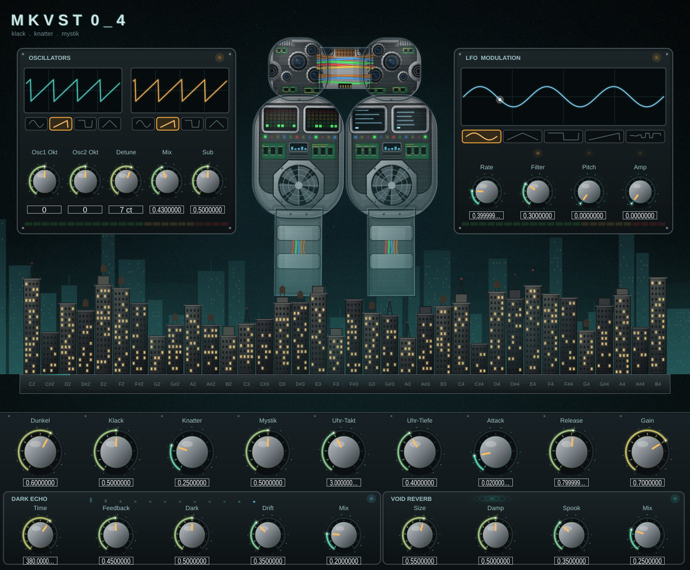

# mkvst0_4

Synthesizer (VST3 / Audio Unit / Standalone) mit JUCE 8.
 Standard-DSP-Formeln, eigene Architektur, eigene Oberfläche.

## Download

| System | Installer |
|---|---|
| Windows (64 Bit) | [mkvst0_4-0.4.0-Windows-Setup.exe](https://github.com/mopamin/mkvst/releases/latest/download/mkvst0_4-0.4.0-Windows-Setup.exe) |
| macOS (Apple Silicon + Intel) | [mkvst0_4-0.4.0-macOS.pkg](https://github.com/mopamin/mkvst/releases/latest/download/mkvst0_4-0.4.0-macOS.pkg) |
| Linux (Debian/Ubuntu) | [mkvst0_4-0.4.0-Linux-amd64.deb](https://github.com/mopamin/mkvst/releases/latest/download/mkvst0_4-0.4.0-Linux-amd64.deb) |
| Linux (andere) | [mkvst0_4-0.4.0-Linux-x86_64.tar.gz](https://github.com/mopamin/mkvst/releases/latest/download/mkvst0_4-0.4.0-Linux-x86_64.tar.gz), entpacken und `./install.sh` starten |

Alle Versionen: [Releases](https://github.com/mopamin/mkvst/releases)

Die Installer sind nicht kostenpflichtig signiert, deshalb warnt das System beim ersten Öffnen:
- **macOS:** Rechtsklick auf die .pkg-Datei, „Öffnen“, dann nochmals „Öffnen“
  (oder Systemeinstellungen, Datenschutz & Sicherheit, „Trotzdem öffnen“).
- **Windows:** „Weitere Informationen“, dann „Trotzdem ausführen“.

Installiert wird das VST3-Plug-in (macOS zusätzlich Audio Unit) und die Standalone-App.

## Bauen (Mac)

1. Werkzeuge: `xcode-select --install` und `brew install cmake git`
2. Im Projektordner:  `./build.sh`
   (lädt JUCE automatisch herunter, baut für Apple Silicon und Intel)

Installiert wird nach:
- `~/Library/Audio/Plug-Ins/VST3/mkvst0_4.vst3`
- `~/Library/Audio/Plug-Ins/Components/mkvst0_4.component`

Standalone-App zum Testen ohne DAW: `build/Mkvst04_artefacts/Release/Standalone/mkvst0_4.app`

## Klang

- **Oszillatoren (links):** zwei Oszillatoren mit Wellenform (Sinus, Säge, Rechteck, Dreieck), je Oktave -2..+2,
  Detune von Osc 2 (+-50 Cent), Mix und Sub-Oszillator.
- **LFO (rechts):** Form (Sinus, Dreieck, Rechteck, Säge, Sample & Hold), Rate 0,05 bis 20 Hz und
  getrennte Tiefen für Filter, Tonhöhe (Vibrato) und Lautstärke (Tremolo).
- **Unten, Reihe 1:** Dunkel (Filter), Klack, Knatter (Bitcrusher), Mystik (FM), Uhr-Takt/-Tiefe, Attack, Release, Gain.
- **Unten, Reihe 2, eigene Effekte (`Source/Mkvst04Fx.h`):**
  - **Dark Echo:** Ping-Pong-Echo, dessen Wiederholungen mit jedem Durchlauf dunkler und sättigender werden
    (Time, Feedback, Dark, Drift = unregelmäßiges Atmen der Zeit, Mix).
  - **Void Reverb:** Hall aus acht verkoppelten Verzögerungsleitungen (Feedback-Delay-Network) mit
    Dämpfung und Sättigung im Rückweg (Size, Damp, Spook = schwebende Modulation, Mix).
  Die Rechenwege stehen als Kommentare in der Datei.

## Bedienung

- Häuser der Skyline anklicken oder darüber ziehen = Noten spielen (C2 bis B4, höhere Türme = C-Töne,
  niedrigere dunkle Häuser = Halbtöne). Externes MIDI leuchtet in der Skyline mit.
- Wellenform-Symbole anklicken = Form wählen.
- Klick auf eine Figur = Klang-Parameter zufällig mutieren (mit Glitch-Effekt).
- Regler sind animiert: kreisender Punktring (schneller bei hohem Wert), LED-Striche bis zum Wert, leuchtender
  Kopf mit Kometenschweif, Wellenring bei jeder Änderung, Metallkappe wird beim Anfassen eingedrückt.
  Auch Automation aus der DAW lässt die Regler und die Aktivitäts-LEDs der Felder aufleuchten.

## Aussehen

Zwei Cyborg-Figuren ohne Arme mit gemeinsamem Kopf nach dem Referenzbild: Brust mit LED-Pegeln (links) und
Terminals (rechts), Platinen, Mini-Display, Lüfter im Achteck, Kragen und Beine; Köpfe mit Kühlrippen, Platinen,
verschiedenen Kameras, Ohr-Scheiben und kupferfarbenem Prozessor über den Kabelbündeln.

Für einen fotoähnlichen Eindruck: gebürstetes Metall, weiche Schatten an den Rändern (Volumen), Glanzlichter,
türkises Kantenlicht vom Himmel, eine dunstige zweite Stadt am Horizont (Tiefe), Hausfassaden mit Schattenseite,
Gesims, Stockwerkslinien, dunklen Glasfenstern und leuchtenden Fenstern mit Lichtschein, dazu feines Filmkorn.
Alles wird als Vektorgrafik gezeichnet und ist deshalb auf Retina-Bildschirmen gestochen scharf.

Beim Spielen zucken Blitze aus der Hauptkamera des Kopfes zum Dach des Hauses, Funken sprühen, der Himmel
leuchtet auf, die Nachbarhäuser leuchten mit.

## Dateien

| Datei | Inhalt |
|---|---|
| `Source/Mkvst04Voice.h` | Klangerzeugung (Oszillatoren, LFO, Filter, Klack, Knatter, Hüllkurve) mit Mathe-Kommentaren |
| `Source/Mkvst04Fx.h` | Eigene Effekte Dark Echo und Void Reverb mit Mathe-Kommentaren |
| `Source/Mkvst04Processor.*` | Parameter, MIDI, Audio-Verarbeitung |
| `Source/Mkvst04Editor.*` | Oberfläche und Effekte |

Name, Version und IDs stehen in `CMakeLists.txt` (`PLUGIN_NAME`, `PRODUCT_NAME`, `VERSION`, `BUNDLE_ID`).
